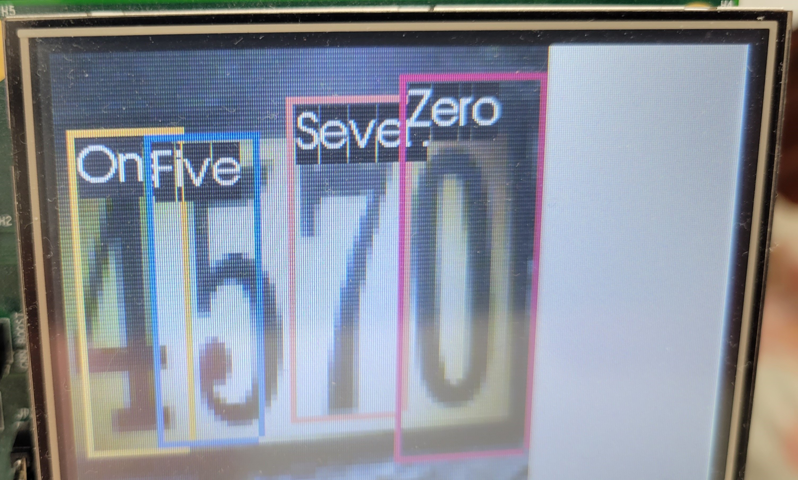

# Digit Detection Demo


Description
-----------

This demo shows a tiny SSD network, trained to localize and recognize digits in images.

The image input size is 74x74 pixels RGB which is 74x74x3 in HWC format.

## Software

### Build and Flash the MAX78000FTHR

From this project directory, use the CodeFusion CLI and SDK 2.1.0. The project selects the `FTHR_RevA` board support package. Use the release profile to keep `-O2` for the camera DMA timing.

```sh
CFS=/home/littlebug/Downloads/School/cli_codefusion/cfs
"$CFS" build --profile release
"$CFS" flash --profile release
```

The build produces `build/release/digit-detection-demo.elf`. Connect the board with a data-capable Micro-USB cable to use its onboard DAPLink programmer. Add `--dry-run` to the flash command to preview it. [MAX78000FTHR board guide](https://www.analog.com/media/en/technical-documentation/data-sheets/max78000fthr.pdf)

The demo prints detections and timing over the USB serial console at 115200 baud. Use `ports` to find the board's device and substitute it below if needed.

```sh
"$CFS" ports
"$CFS" monitor --port /dev/ttyACM0
```

### Project-Specific Build Notes

* By default, this project uses [camera mode](#camera-mode). Enable [offline mode](#offline-mode) by defining `USE_SAMPLEDATA` in [example_config.h](example_config.h).

    ```C
    #define USE_SAMPLEDATA
    // ^ Uncomment this to use static sample data.
    // ^ Comment this out to use live camera data.
    ```

* This project supports output to a TFT display.  This feature can be toggled via the `TFT_ENABLE` option defined in [example_config.h](example_config.h)

    * For the MAX78000EVKIT, the TFT display is **enabled** by default.  To _disable_ it, undefine `TFT_ENABLE`.

        ```C
        #ifdef BOARD_EVKIT_V1
        //#define TFT_ENABLE
        #endif
        ```

    * For the MAX78000FTHR, the TFT display is **disabled** by default.  The TFT display is not supplied with the MAX78000 Feather board. The compatible 2.4'' TFT FeatherWing display can be ordered [here](https://learn.adafruit.com/adafruit-2-4-tft-touch-screen-featherwing).  To _enable_ the display code, uncomment `#define TFT_ENABLE` in [example_config.h](example_config.h)

        ```C
        #ifdef BOARD_FTHR_REVA
        #define TFT_ENABLE
        #endif
        ```

### Offline Mode

If the project is built with `#define USE_SAMPLEDATA`, it runs inference on the image in `sampledata.h`. The serial console reports detections. With `TFT_ENABLE` set, the display shows the image with detection boxes.

This mode uses a header file "sampledata.h" containing RGB image data and it should be included in the project to use it as an input to the CNN network. 

To create your own header file follow these steps:

1. Navigate to Resources directory. $ cd Resources

2. Download image in this directory.

3. Open 'rgb.py' file and change the name of the image file on line 8:

   im = (Image.open('image_filename.format')). Save the changes.

4. Now generate a header file using this command: python3 rgb.py

5. Use this header file in your main.c

### Camera Mode

To operate in this mode, leave `USE_SAMPLEDATA` commented out in `example_config.h`.

The MAX78000FTHR uses its onboard OVM7692 camera. In the default RGB565 mode, the demo downsamples the captured image to 74x74 pixels and converts it to signed RGB for the CNN. With `TFT_ENABLE` set, it also displays the camera image.

The data received from camera interface is an unsigned data and should be converted to signed data before feeding to the CNN network.



### References

https://github.com/MaximIntegratedAI/MaximAI_Documentation
